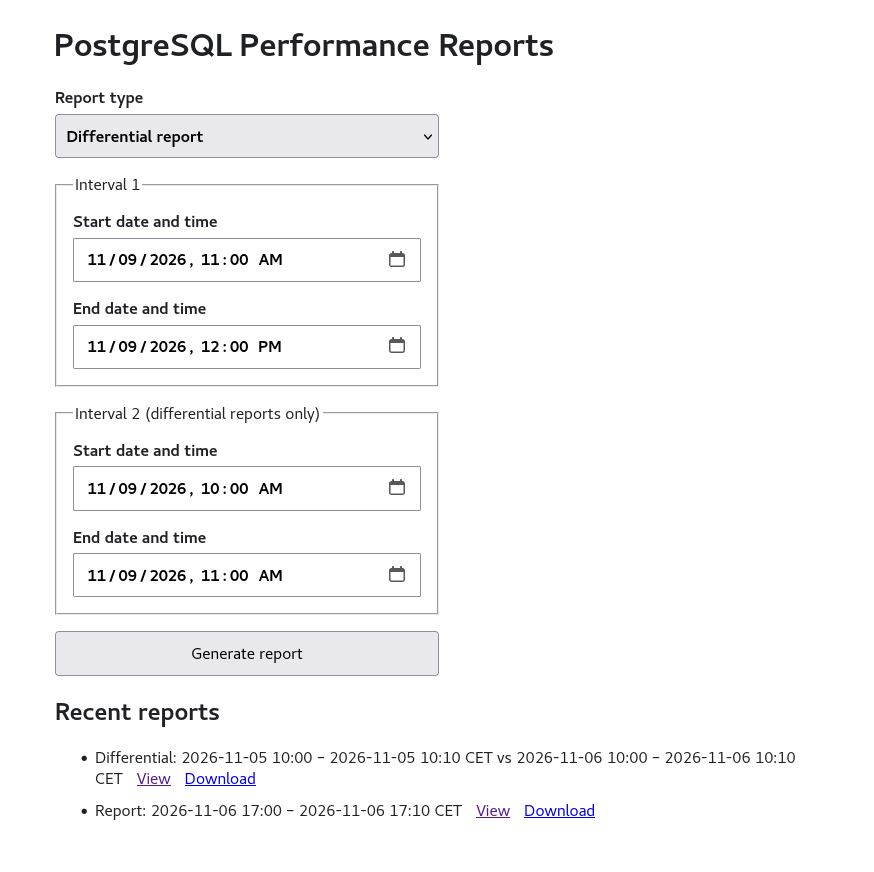

# pgprofile-web

`pgprofile-web` is a deliberately small CGI application that turns a date range
into a cached PostgreSQL `pg_profile` HTML report. It runs behind Nginx and
`fcgiwrap`; it does not need Uvicorn, FastAPI, a worker, or a REST API.



## Requirements

- Python 3.9 or newer
- `psycopg` 3
- PyYAML 6
- Nginx and `fcgiwrap`
- An existing `pg_profile` repository where these queries are valid:

  ```sql
  SELECT public.get_report(
      $1::name,
      tstzrange($2, $3, '[)')
  );
  SELECT public.get_diffreport(
      $1::name,
      tstzrange($2, $3, '[)'),
      tstzrange($4, $5, '[)')
  );
  ```

The PostgreSQL role needs only connection permission and permission to execute
the report function and read anything that function requires. Do not use a
superuser role.

## Install

The exact package installation method depends on the RHEL environment. A basic
application layout is:

```text
/opt/pgprofile-web/
├── pgprofile-web.cgi
└── pgprofile_web.py

/etc/pgprofile-web/
├── config.yaml
├── pgpass                 optional
└── root.crt               when required by TLS configuration

/var/cache/pgprofile-web/
```

Install the Python dependencies from `requirements.txt`, copy
`config.example.yaml` to `/etc/pgprofile-web/config.yaml`, and adapt it. The CGI
entry point must be executable. The user running `fcgiwrap` must be able to:

- traverse `/opt/pgprofile-web` and execute `pgprofile-web.cgi`;
- read the Python module and configuration;
- create files in `/var/cache/pgprofile-web`;
- read the PostgreSQL passfile and TLS CA file, when configured.

Suggested permissions are a cache directory owned by the `fcgiwrap` user with
mode `0700`, report files with mode `0600`, and a passfile with mode `0600`.
Do not put the database password in YAML.

The report functions are configurable. The regular function must accept one
`tstzrange`; the differential function must accept two:

```yaml
reports:
  cache_directory: /var/cache/pgprofile-web
  max_interval_hours: 24
  recent_reports: 10
  server_name: local
  regular_function: public.get_report
  differential_function: public.get_diffreport
```

Function names must use the `schema.function` form. They are validated and
quoted as PostgreSQL identifiers; date/time values remain bound query
parameters. `server_name` is the monitored server name inside the `pg_profile`
repository, not the PostgreSQL database hostname.

Set `PGPROFILE_WEB_CONFIG` in the `fcgiwrap` service environment only when the
configuration is not at `/etc/pgprofile-web/config.yaml`.

## Deployment

For a complete RHEL deployment example—including `fcgiwrap` systemd units,
Nginx, filesystem permissions, and SELinux—see
[Deploy with Nginx and fcgiwrap](doc/fcgiwrap.md).

## Run tests

From the project directory:

```sh
python3 -m unittest discover -s tests -v
```

## Debug a PostgreSQL connection

`pgprofile_web.py` has a read-only connection check. Run it as the same `nginx`
user used by `fcgiwrap` so that file permissions, the passfile, TLS certificate
access, Python dependencies, and SELinux policy match the web request:

```sh
sudo -H -u nginx /usr/bin/python3 /opt/pgprofile-web/pgprofile_web.py \
  --config /etc/pgprofile-web/config.yaml \
  --check-connection
```

If the application uses a virtual environment, replace `/usr/bin/python3` with
that environment's Python executable. The successful output is similar to:

```text
PostgreSQL connection: OK
Database: postgres
User: pgprofile_web
Server: 192.0.2.10:5432
Monitored server: local
Regular function: get_report(name,tstzrange,text,boolean,name[])
Differential function: get_diffreport(name,tstzrange,tstzrange,text,boolean,name[])
```

This command does not generate or cache a report. It connects using the exact
settings from YAML, runs one read-only query, and verifies that
both configured report functions are visible to the configured role.
Connection, TLS, authentication, passfile, and permission errors are printed
to stderr. The command exits with a nonzero status on any failure.

To use the default configuration path, the shorter form is:

```sh
sudo -H -u nginx /usr/bin/python3 /opt/pgprofile-web/pgprofile_web.py \
  --check-connection
```

After a failure through Nginx, also inspect the service journal and SELinux
audit log:

```sh
journalctl -u fcgiwrap@nginx.service -n 100 --no-pager
sudo ausearch -m AVC -ts recent
```

## Local CGI smoke test

Create a configuration whose cache points to a writable directory, then run:

```sh
REQUEST_METHOD=GET \
SCRIPT_NAME=/pgprofile-web \
PGPROFILE_WEB_CONFIG=./config.example.yaml \
./pgprofile-web.cgi
```

This prints CGI headers followed by the HTML form. Generating an actual report
requires working database and credential settings.

## Behavior

- The default interval is the previous completed hour in the configured zone.
- Regular reports use Interval 1. Differential reports compare Interval 1 with
  Interval 2 using `get_diffreport(name, tstzrange, tstzrange)`.
- Interval 1 defaults to the previous completed hour. Interval 2 defaults to
  the completed hour immediately before Interval 1.
- Form input during DST gaps or ambiguous clock changes is rejected.
- Intervals longer than `max_interval_hours` are rejected.
- Identical intervals reuse the same cached report.
- A per-report filesystem lock prevents identical simultaneous requests from
  running duplicate PostgreSQL queries.
- Cached files may be deleted manually; PostgreSQL data is unaffected.
- Generated HTML is served with the embedded JavaScript required by modern
  `pg_profile` reports enabled. External scripts, network requests, plugins,
  framing, and form submissions remain blocked by Content Security Policy.
